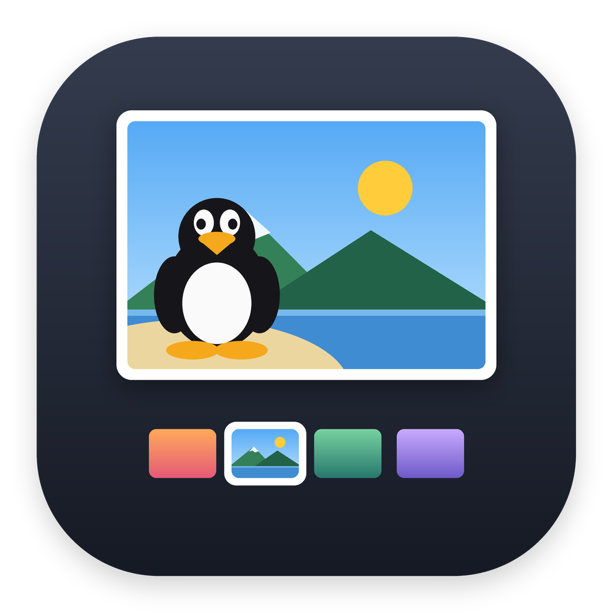
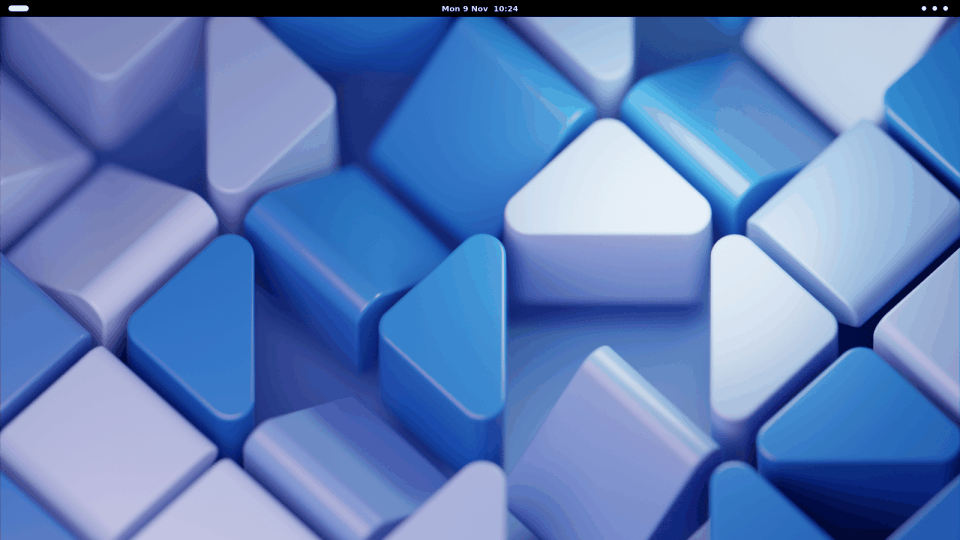
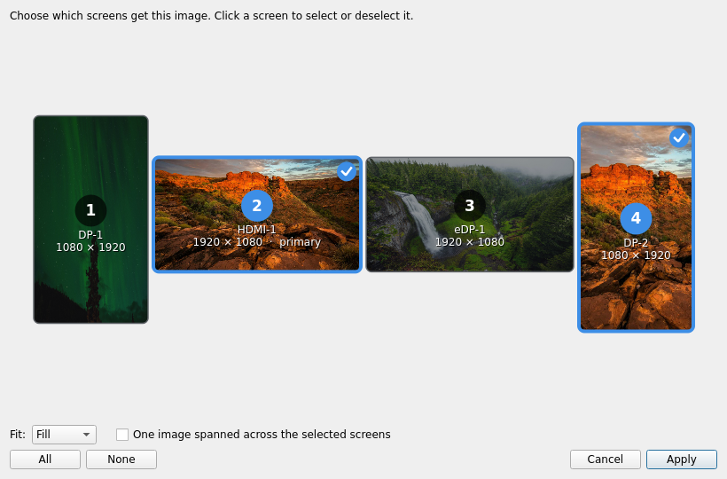

<p align="center">
  
</p>

<h1 align="center">PicPhotoViewer</h1>

<p align="center">
  Visor de fotos para Linux que se abre <b>sobre el escritorio</b>, como el clásico visor de fotos de Picasa.<br>
  <a href="#instalar">Instalar</a> · <a href="#qué-hace">Qué hace</a> · <a href="#atajos">Atajos</a> · <a href="README.md">English</a>
</p>

<p align="center">
  
</p>

Doble clic en una foto y aparece sobre una capa oscura translúcida, encima de lo que estabas
haciendo, con la tira de fotos de la carpeta y una barra de botones al pie. Clic fuera de la
foto (o Esc) y desaparece. Sin ventanas que acomodar ni bibliotecas que importar.

Además pone una foto como **fondo de escritorio solo en las pantallas que elijas** y como
**fondo de la pantalla de inicio de sesión (GDM)**, desde el menú contextual de Nautilus.

> Proyecto independiente, sin relación con Google ni con Picasa. Los íconos de la barra están
> dibujados en el propio código.

## Qué hace

- **Se abre sobre el escritorio**: pantalla completa en el monitor donde está el puntero, fondo translúcido.
- **Zoom** con la rueda (donde está el puntero), `+` `−` `1:1`, doble clic, arrastrar.
- **Tira de fotos** de la carpeta, anterior / siguiente, **presentación** con fundido (F5).
- **Rota el archivo sin pérdida** — JPEG con `exiftran`, que además corrige la orientación EXIF.
- **Estrellas** guardadas en `.picasa.ini`, compatibles con las que ya marcó Picasa.
- Copiar, imprimir, papelera, propiedades con datos EXIF, abrir con editor, abrir carpeta.
- **Fondo de escritorio por pantalla**: un diagrama con la posición y orientación reales de
  tus monitores; se elige una, varias o todas, y opcionalmente una sola imagen extendida. Las
  demás pantallas conservan su fondo.
- **Fondo de inicio de sesión (GDM)**, con contraseña de administrador. Se restaura al desinstalar.
- **Menú contextual de Nautilus**: abrir, poner como fondo de escritorio, poner como fondo de inicio de sesión.
- En español e inglés, según el idioma del sistema.

<p align="center">
  
</p>

## Instalar

**Debian 13 (trixie) con GNOME.** Una línea:

```bash
curl -fsSL https://raw.githubusercontent.com/nktrabajo/Pic-Photo-Viewer/main/instalar.sh | bash
```

Baja el `.deb` de la última [release](https://github.com/nktrabajo/Pic-Photo-Viewer/releases),
verifica su SHA256, lo instala con `apt`, reinicia Nautilus para que aparezca el menú
contextual y pregunta si abrir las imágenes con PicPhotoViewer al hacer doble clic.

**¿Preferís apt?** El paquete viene de un repositorio APT firmado:

```bash
sudo curl -fsSLo /usr/share/keyrings/picphotoviewer-archive-keyring.gpg \
  https://nktrabajo.github.io/Pic-Photo-Viewer/picphotoviewer-archive-keyring.gpg
sudo curl -fsSLo /etc/apt/sources.list.d/picphotoviewer.sources \
  https://nktrabajo.github.io/Pic-Photo-Viewer/picphotoviewer.sources
sudo apt update && sudo apt install picphotoviewer
```

De cualquiera de las dos formas, las versiones nuevas llegan con `sudo apt upgrade` (el
paquete trae la definición del repositorio), y el visor también avisa cuando sale una.

Para hacerlo el visor predeterminado después: menú ▼ → «Usar como visor de imágenes
predeterminado», o `picphotoviewer --predeterminado`.

Requiere Python 3.11+ y PySide6 de los repositorios de Debian (`apt` los instala solos).
Probado en Debian 13 con GNOME 48 en X11. En Wayland no está probado.

## Desinstalar

```bash
curl -fsSL https://raw.githubusercontent.com/nktrabajo/Pic-Photo-Viewer/main/desinstalar.sh | bash
```

Quita el paquete y, si habías cambiado el fondo de inicio de sesión, **devuelve el tema
original de GNOME**. Si tu fondo de escritorio actual lo armó PicPhotoViewer, lo guarda en
`~/.local/share/backgrounds/` para que el escritorio no quede vacío. Pregunta antes de
borrar tus preferencias; las estrellas (`.picasa.ini`) no se tocan. `sudo apt purge
picphotoviewer` también restaura el tema de GDM.

## Sobre la pantalla de bloqueo

GNOME 48 ya no tiene un fondo de bloqueo propio: al bloquear muestra el fondo del escritorio
difuminado. Lo que PicPhotoViewer cambia es el fondo de **GDM**, la pantalla de inicio de
sesión (al encender, al cerrar sesión, al cambiar de usuario). Para hacerlo parchea el tema
de gnome-shell guardando antes una copia del original. Cuando gnome-shell se actualiza, el
fondo se vuelve a aplicar solo, y al desinstalar se restaura el tema original.

## Atajos

| Tecla | Acción |
|---|---|
| ← → / Re Pág Av Pág | anterior / siguiente |
| Inicio / Fin | primera / última |
| + − / rueda | acercar / alejar |
| 1 / 0 | tamaño real / ajustar |
| F5 | presentación |
| Ctrl+R / Ctrl+Mayús+R | rotar derecha / izquierda |
| Ctrl+8 o S | estrella |
| Ctrl+C / Ctrl+P / Ctrl+E | copiar / imprimir / abrir con editor |
| Supr | papelera |
| F1 | ayuda |
| Esc | cerrar |

## Configuración

Por usuario, en `~/.config/picphotoviewer/config.ini`, sección `[general]`:

| Clave | Por defecto | |
|---|---|---|
| `idioma` | `auto` | `auto`, `en` o `es` |
| `editor` | *(vacío)* | comando para «Abrir con editor»; vacío = el primero que exista de gimp, pinta, krita… |
| `segundos_presentacion` | `4` | segundos por foto en la presentación |
| `opacidad_fondo` | `0.72` | cuánto se oscurece el escritorio detrás (0–1) |
| `buscar_actualizaciones` | `si` | `no` para no consultar GitHub por versiones nuevas |

## Desarrollo

```bash
python3 -I src/main.py foto.jpg          # correr desde el código
python3 -I tools/pruebas/prueba_todo.py  # pruebas (sin tocar tu escritorio)
python3 -I tools/pruebas/prueba_visor.py
./tools/construir_deb.sh                 # dist/picphotoviewer_<versión>_all.deb + .sha256
```

Capturas: fotos de [Unsplash](https://unsplash.com) (vía [Lorem Picsum](https://picsum.photos)),
fondo de escritorio de GNOME.

## Licencia

MIT — ver [LICENSE](LICENSE).
