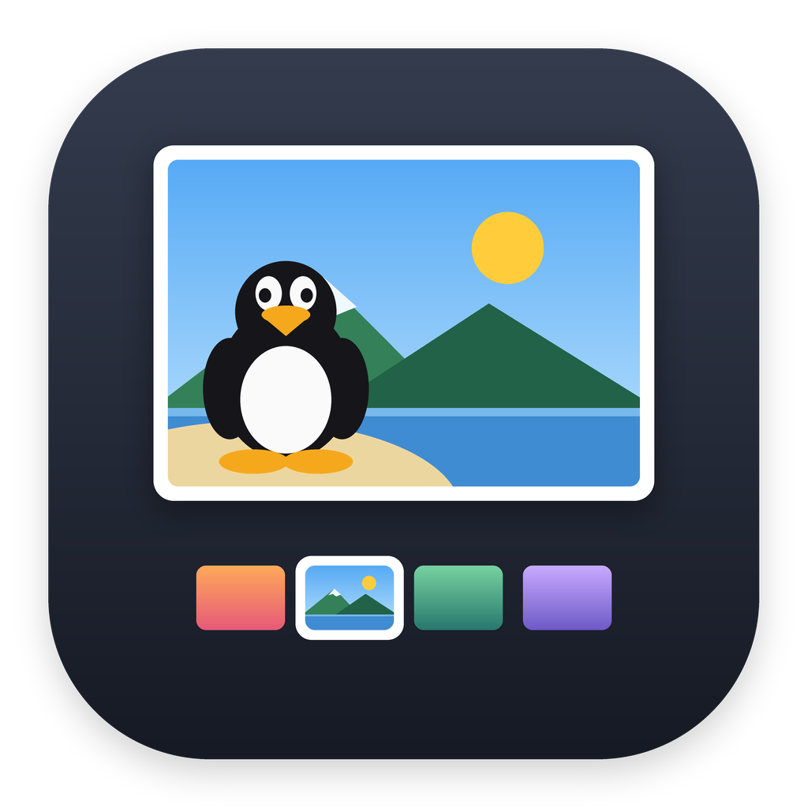
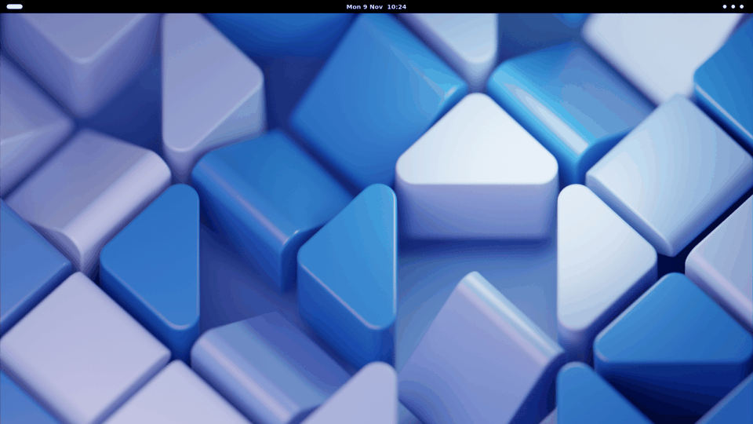
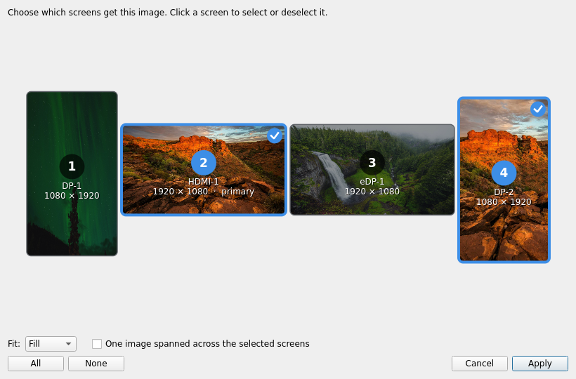
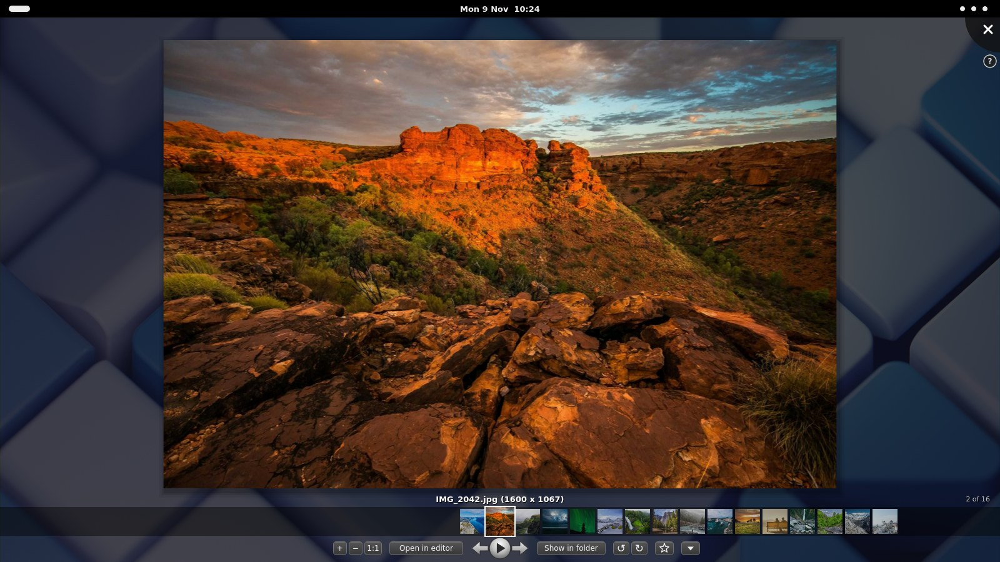
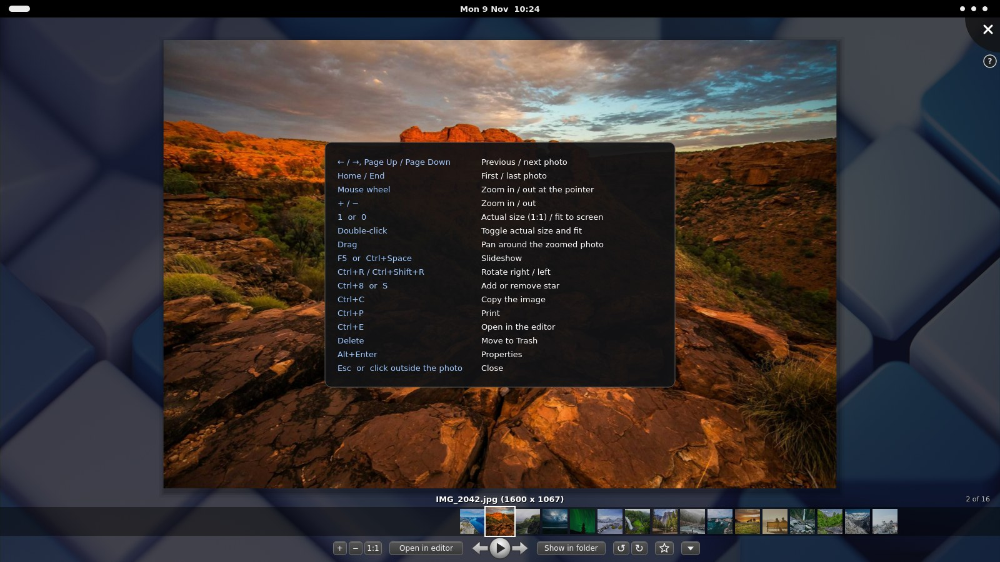

<p align="center">
  
</p>

<h1 align="center">PicPhotoViewer</h1>

<p align="center">
  A photo viewer for Linux that opens <b>over your desktop</b>, like the classic Picasa Photo Viewer.<br>
  <a href="#install">Install</a> · <a href="#features">Features</a> · <a href="#shortcuts">Shortcuts</a> · <a href="README.es.md">Español</a>
</p>

<p align="center">
  
</p>

Double-click a photo and it appears on top of a translucent dark layer over whatever you
were doing, with a filmstrip of the folder and a small toolbar underneath. Click outside the
photo (or press Esc) and it's gone. No window to manage, no library to import.

It also sets a photo as the **desktop background on just the monitors you pick**, and as the
**login screen (GDM) background**, right from the Nautilus context menu.

> Independent project, not affiliated with Google or Picasa. All toolbar icons are drawn in code.

## Features

- **Opens over the desktop**: full screen on the monitor under your pointer, translucent backdrop.
- **Zoom** with the wheel (where the pointer is), `+` `−` `1:1`, double-click, drag to pan.
- **Filmstrip** of the folder, previous / next, **slideshow** with crossfade (F5).
- **Lossless rotation of the file itself** — JPEG through `exiftran`, which also fixes the EXIF orientation.
- **Stars** stored in `.picasa.ini`, compatible with the ones Picasa already set.
- Copy, print, move to trash, properties with EXIF data, open in your editor, show in folder.
- **Desktop background per monitor**: a diagram of your real monitor layout (position and
  orientation); pick one, several or all, optionally one image spanned across them. The other
  monitors keep their background.
- **Login screen background (GDM)**, with administrator password. Restored on uninstall.
- **Nautilus context menu**: open, set as desktop background, set as login screen background.
- English and Spanish, following the system language.

<p align="center">
  
</p>

<details>
<summary>More screenshots</summary>

<p align="center">
  <br><br>
  
</p>
</details>

## Install

**Debian 13 (trixie) with GNOME.** One line:

```bash
curl -fsSL https://raw.githubusercontent.com/nktrabajo/Pic-Photo-Viewer/main/instalar.sh | bash
```

It downloads the `.deb` from the latest [release](https://github.com/nktrabajo/Pic-Photo-Viewer/releases),
checks its SHA256, installs it with `apt`, restarts Nautilus so the context menu shows up, and
asks whether to open images with PicPhotoViewer on double-click.

**Prefer apt?** The package comes from a signed APT repository:

```bash
sudo curl -fsSLo /usr/share/keyrings/picphotoviewer-archive-keyring.gpg \
  https://nktrabajo.github.io/Pic-Photo-Viewer/picphotoviewer-archive-keyring.gpg
sudo curl -fsSLo /etc/apt/sources.list.d/picphotoviewer.sources \
  https://nktrabajo.github.io/Pic-Photo-Viewer/picphotoviewer.sources
sudo apt update && sudo apt install picphotoviewer
```

Either way, new versions arrive with `sudo apt upgrade` (the package ships the repository
definition), and the viewer also tells you when one is out.

To make it the default image viewer later: ▼ menu → “Make default image viewer”, or
`picphotoviewer --predeterminado`.

Requires Python 3.11+ and PySide6 from the Debian repositories (`apt` pulls them in). Tested on
Debian 13 with GNOME 48 on X11. Wayland is untested.

## Uninstall

```bash
curl -fsSL https://raw.githubusercontent.com/nktrabajo/Pic-Photo-Viewer/main/desinstalar.sh | bash
```

Removes the package and, if you changed the login screen background, **puts the original
GNOME theme back**. If your current desktop background was composed by PicPhotoViewer it is
kept in `~/.local/share/backgrounds/`, so your desktop doesn't go blank. It asks before
deleting your preferences; stars (`.picasa.ini`) are never touched. `sudo apt purge
picphotoviewer` also restores the GDM theme.

## About the lock screen

GNOME 48 has no separate lock screen background: it shows your desktop background, blurred.
What PicPhotoViewer changes is the **GDM** background — the login screen you see at boot,
after logging out and when switching users. It patches the gnome-shell theme after saving a
copy of the original; when gnome-shell is upgraded the background is re-applied
automatically, and uninstalling restores the original theme.

## Shortcuts

| Key | Action |
|---|---|
| ← → / Page Up, Page Down | previous / next |
| Home / End | first / last |
| + − / wheel | zoom in / out |
| 1 / 0 | actual size / fit |
| F5 | slideshow |
| Ctrl+R / Ctrl+Shift+R | rotate right / left |
| Ctrl+8 or S | star |
| Ctrl+C / Ctrl+P / Ctrl+E | copy / print / open in editor |
| Delete | move to trash |
| F1 | help |
| Esc | close |

## Settings

Per-user, in `~/.config/picphotoviewer/config.ini`, section `[general]`:

| Key | Default | |
|---|---|---|
| `idioma` | `auto` | `auto`, `en` or `es` |
| `editor` | *(empty)* | command for “Open in editor”; empty = first found of gimp, pinta, krita… |
| `segundos_presentacion` | `4` | seconds per photo in the slideshow |
| `opacidad_fondo` | `0.72` | how much the desktop behind is darkened (0–1) |
| `buscar_actualizaciones` | `si` | `no` to stop checking GitHub for new versions |

## Development

```bash
python3 -I src/main.py photo.jpg          # run from source
python3 -I tools/pruebas/prueba_todo.py   # tests (they never touch your desktop)
python3 -I tools/pruebas/prueba_visor.py
./tools/construir_deb.sh                  # dist/picphotoviewer_<version>_all.deb + .sha256
```

Python 3 + PySide6 (Qt Widgets), no pip dependencies. Code comments and internal docs are in
Spanish. Issues and pull requests are welcome in English or Spanish.

Screenshots: photos from [Unsplash](https://unsplash.com) (via [Lorem Picsum](https://picsum.photos)),
desktop wallpaper from GNOME.

## License

MIT — see [LICENSE](LICENSE).
